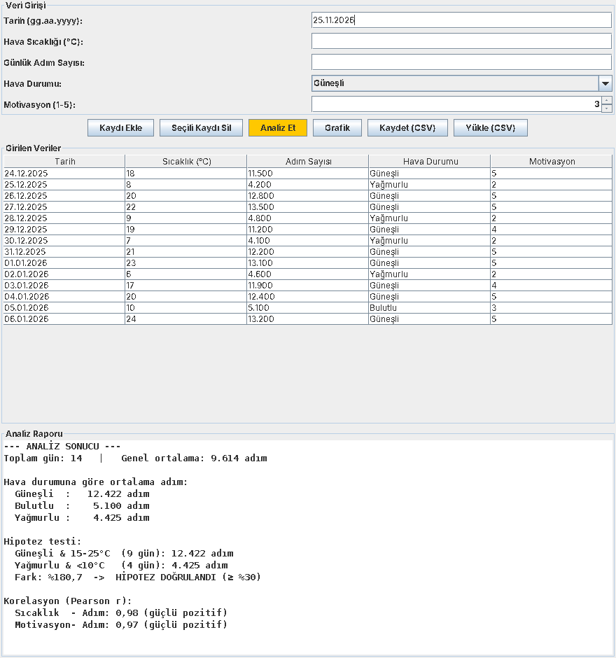
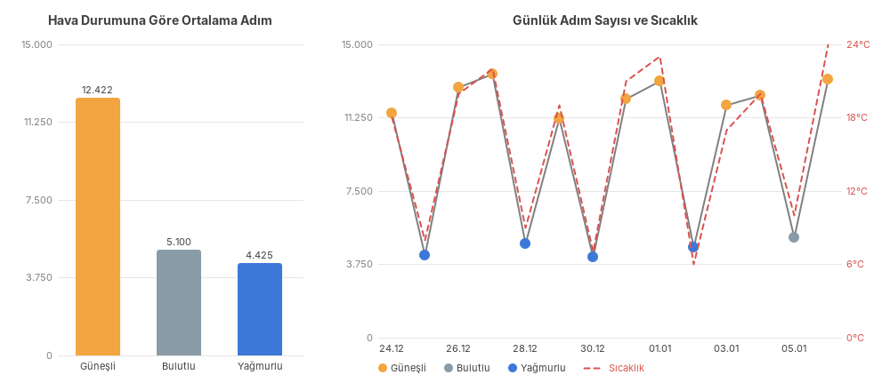

# 🌦️ HavaAdım: Hava Durumunun Fiziksel Aktiviteye Etkisi

Hava sıcaklığı ve hava durumunun (güneşli, bulutlu, yağmurlu) günlük adım sayısına etkisini inceleyen, **Java Swing** ile geliştirdiğim bir veri takip ve analiz uygulaması.

Bu projeyi **Yazılım Proje Yönetimi** dersinde, 2 kişilik takımımızla (**BitByBit**) **Scrum** metodolojisini uygulayarak 2 sprintte geliştirdik. 14 gün boyunca gerçek veri toplayıp kurduğumuz hipotezi test ettik.



## 👩‍💻 Projedeki Rolüm

- **Scrum Master** olarak sprint planlama, daily scrum, sprint review ve retrospektif toplantılarını yönettim.
- Product backlog'u user story formatında hazırladım ve sprint hedeflerini belirledim.
- 14 günlük veri toplama sürecini koordine ettim ve hipotez testinin sonuçlarını raporladım.
- Uygulamanın son hâlinde hava durumu ve motivasyon girişi, CSV kaydetme/yükleme, istatistiksel analiz (hipotez testi, korelasyon) ve grafik özellikleri eklendi; giriş doğrulama ve proje yapılandırma hataları giderildi.

## 🔬 Deney ve Hipotez

> *Hava sıcaklığı 15-25°C arasında ve hava güneşli olduğunda, günlük adım sayısı 10°C altındaki yağmurlu günlere göre **en az %30** daha yüksektir.*

**Takip ettiğimiz veriler** (24.12.2025 – 06.01.2026, 14 gün):

| Tür | Veri |
|---|---|
| Nicel | Günlük adım sayısı |
| Nitel | Motivasyon puanı (1-5) |
| Bağlamsal | Sıcaklık (°C) ve hava durumu |

**Sonuç** (`data/ornek_veri.csv` üzerinden uygulamanın hesapladığı değerler):

| Grup | Gün | Ortalama Adım |
|---|---|---|
| Güneşli & 15-25°C | 9 | 12.422 |
| Yağmurlu & <10°C | 4 | 4.425 |
| **Fark** | | **%180,7 → Hipotez doğrulandı ✅** |

Sıcaklık ile adım sayısı arasındaki korelasyon **r = 0,98** (güçlü pozitif) çıktı. En dikkat çekici bulgu şuydu: adım sayısını en çok düşüren faktör sıcaklıktan çok **yağıştı**.



## ✨ Özellikler

- Tarih, sıcaklık, adım sayısı, hava durumu ve motivasyon girişi
- Giriş doğrulama: geçerli tarih, pozitif adım sayısı, 1-5 arası motivasyon, aynı güne tekrar kayıt engeli
- Verileri **CSV** olarak kaydetme ve yükleme (Excel'de doğrudan açılır)
- Analiz raporu:
  - Hava durumuna göre ortalama adım
  - Hipotez testi (yüzde fark)
  - Pearson korelasyonu (sıcaklık-adım, motivasyon-adım)
- Harici kütüphane gerektirmeyen grafikler (bar ve çizgi grafik, Java 2D)

## 📋 Scrum Süreci

| | Sprint 1 (24.12 – 30.12.2025) | Sprint 2 (01.01 – 08.01.2026) |
|---|---|---|
| **Hedef** | Veri giriş sistemi ve ilk 7 günlük veri | 14 günlük verinin tamamlanması, analiz ve grafikler |
| **İyi giden** | Günlük toplantılar aksatılmadı, altyapı hızlı kuruldu | Hipotez 14 günlük veriyle test edildi |
| **Zorluk** | Kütüphane sürüm çakışmaları | Analiz kısmı tahmin edilenden uzun sürdü |
| **Aksiyon** | Bağımlılıkları proje başında sabitlemek | "Veri analizi" işini daha küçük görevlere bölmek |

**Product Backlog:**

| ID | User Story | Öncelik |
|---|---|---|
| PB1 | Günlük adım sayımı girmek istiyorum ki fiziksel aktivitemi takip edebileyim. | Yüksek |
| PB2 | Hava durumunu ve sıcaklığı seçmek istiyorum ki çevresel etkiyi görebileyim. | Yüksek |
| PB3 | Motivasyonumu (1-5) puanlamak istiyorum ki ruh halimi analiz edebileyim. | Orta |
| PB4 | Verilerimi grafik üzerinde görmek istiyorum ki bağlantıyı fark edebileyim. | Orta |

## 🚀 Çalıştırma

**Gereksinim:** Java 21 (JDK)

**NetBeans ile:** *File → Open Project* ile bu klasörü açın ve **Run** butonuna basın.

**Komut satırı ile:**

```bash
javac -encoding UTF-8 -d out src/weatherstepprojectjava/*.java
java -cp out weatherstepprojectjava.WeatherStepProjectJava
```

Örnek veriyi görmek için uygulamada **Yükle (CSV)** butonuna basıp `data/ornek_veri.csv` dosyasını seçin, ardından **Analiz Et** ve **Grafik** butonlarına basın.

## 📁 Proje Yapısı

```
havaadim/
├── src/weatherstepprojectjava/
│   ├── WeatherStepProjectJava.java   # Ana pencere (Swing arayüzü)
│   ├── GunlukKayit.java              # Veri modeli
│   ├── Analiz.java                   # Ortalama, hipotez testi, korelasyon
│   ├── CsvDosya.java                 # CSV kaydetme / okuma
│   └── GrafikPaneli.java             # Bar ve çizgi grafikler
├── data/
│   ├── ornek_veri.csv                # 14 günlük veri seti
│   └── ornek_veri.xlsx               # Aynı verinin Excel hâli
├── images/                           # Ekran görüntüleri
└── nbproject/, build.xml             # NetBeans proje dosyaları
```

## 🛠️ Kullanılan Teknolojiler

Java 21 · Swing · Java 2D · NetBeans · Scrum
